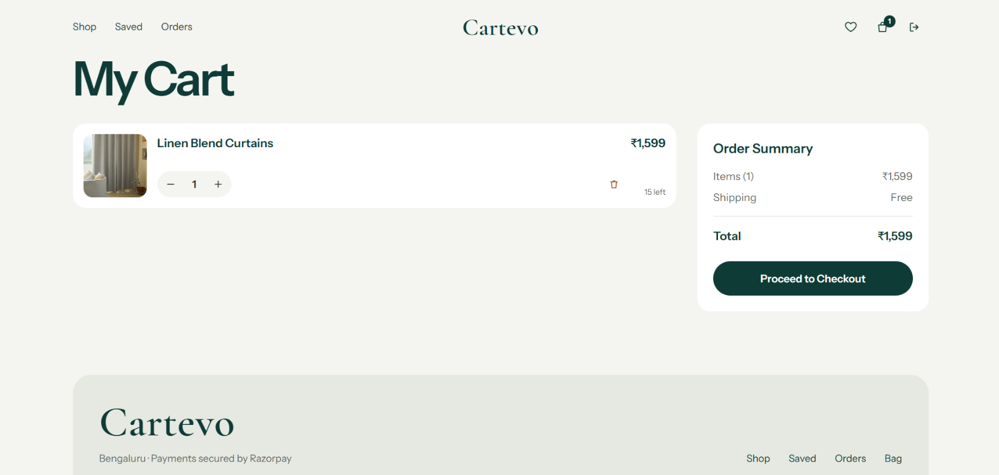
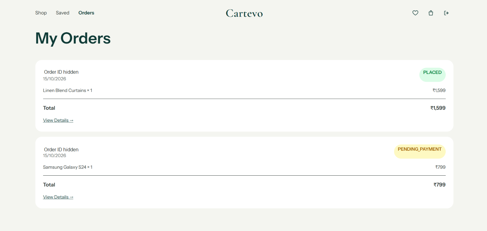
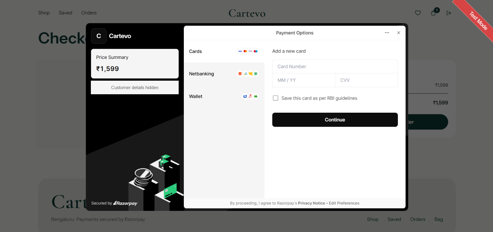
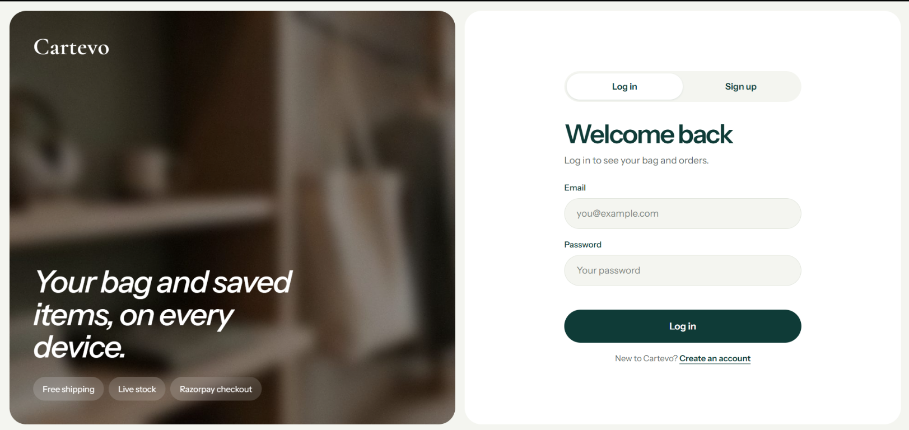

# Cartevo

Cartevo is a full-stack storefront for discovering products across fashion, home, and books. It includes customer accounts, a saved-items list, a shopping cart, order history, and Razorpay checkout.

## Screenshots

| Product catalog | Shopping cart |
| --- | --- |
|  |  |

| Order history | Secure checkout |
| --- | --- |
|  |  |

| Sign in |
| --- |
|  |

## Stack

- Frontend: React, Vite, React Router, Tailwind CSS
- Backend: Node.js, Express
- Database: MongoDB with Mongoose
- Payments: Razorpay

## Requirements

- Node.js 20 or later
- npm
- A MongoDB database (MongoDB Atlas or a local MongoDB instance)
- Razorpay API credentials for payment checkout

## Run locally

Open two terminals from the repository root.

### 1. Configure the backend

Create `BACKEND/.env` from the example:

```powershell
Copy-Item BACKEND/.env.example BACKEND/.env
```

Or on macOS/Linux:

```sh
cp BACKEND/.env.example BACKEND/.env
```

Set `MONGO_URL` to your MongoDB connection string and set `JWT_SECRET` to a long, random value. Add Razorpay test credentials for local payment testing. Do not commit `.env`.

Install dependencies and start the API:

```sh
cd BACKEND
npm install
npm run dev
```

The API defaults to `http://localhost:8001`. Its `/health` endpoint reports whether the database connection is ready.

### 2. Configure and start the frontend

In the second terminal, create `FRONTEND/.env` from the example:

```powershell
Copy-Item FRONTEND/.env.example FRONTEND/.env
```

Or on macOS/Linux:

```sh
cp FRONTEND/.env.example FRONTEND/.env
```

Install dependencies and start Vite:

```sh
cd FRONTEND
npm install
npm run dev
```

Open the local URL printed by Vite (normally `http://localhost:5173`).

### Optional: seed the sample catalog

With the backend `.env` configured for the intended database, run:

```sh
cd BACKEND
npm run seed:products
```

This upserts the sample products defined in `BACKEND/scripts/seedProducts.js`. It writes to the database selected by `MONGO_URL`; review that value before running the command, especially in production.

## Environment variables

| Variable | App | Required | Purpose |
| --- | --- | --- | --- |
| `MONGO_URL` | Backend | Yes | MongoDB connection string |
| `JWT_SECRET` | Backend | Yes | Secret used to sign customer session tokens |
| `RAZORPAY_KEY_ID` | Backend | For checkout | Razorpay key ID; use test credentials locally |
| `RAZORPAY_KEY_SECRET` | Backend | For checkout | Private Razorpay secret; never expose to the browser |
| `CLIENT_URL` | Backend | Production | Comma-separated exact frontend origins allowed by CORS |
| `PORT` | Backend | No | API port; defaults to `8001` |
| `NODE_ENV` | Backend | Production | Set to `production` in production for secure, cross-site cookies |
| `VITE_API_URL` | Frontend | Production | Backend origin, such as `https://api.example.com`; do not add an `/api` suffix |

Only `VITE_` variables are included in the built frontend. Never put database URLs, JWT secrets, Razorpay secrets, or other private credentials in frontend environment variables.

## Production deployment

### Backend

1. Deploy the `BACKEND` directory to a Node.js host that supports persistent environment variables and HTTPS.
2. Configure `MONGO_URL`, `JWT_SECRET`, `RAZORPAY_KEY_ID`, `RAZORPAY_KEY_SECRET`, `CLIENT_URL`, and `NODE_ENV=production` in the hosting provider's secret/environment settings. Set `PORT` only if required by the host; the app honors the host-provided port.
3. Set `CLIENT_URL` to the exact HTTPS origin(s) serving the frontend, comma-separated if there are multiple. Do not include route paths.
4. Allow the backend host to reach MongoDB in your database network-access settings. Keep credentials restricted and rotate any credential that has been exposed.
5. Configure the host health check to request `/health`. A healthy response is HTTP `200` with `{"status":"ok","db":"connected"}`.
6. Configure Razorpay live credentials only when ready to accept real payments, and set the corresponding live keys in the Razorpay dashboard.

### Frontend

1. Build from the `FRONTEND` directory with `npm ci` and `npm run build`.
2. Set `VITE_API_URL` to the HTTPS backend origin in the frontend build environment. Vite embeds this value at build time, so rebuild after changing it.
3. Publish the generated `FRONTEND/dist` directory to a static hosting provider.
4. Configure the static host to serve `index.html` for client-side routes such as `/products/:id`, `/login`, and `/orders`.
5. Use HTTPS for both frontend and backend. Customer authentication uses an HTTP-only cookie with `SameSite=None; Secure` in production. For reliable cookie behavior, host the frontend and API on the same site (for example, `shop.example.com` and `api.example.com`); browsers may block cookies when they are hosted on unrelated sites.

## Checks

Run these from their respective directories:

```sh
# Frontend
npm run lint
npm run build

# Backend
npm start
```

The backend package does not currently define an automated test suite.

## Security notes

- Never commit `.env` files, database credentials, JWT secrets, or payment secrets.
- Use the `.env.example` files as templates only; they intentionally contain placeholders.
- Restrict MongoDB network access and use a dedicated database user with only the permissions the app needs.
- Keep backend and frontend origins aligned with `CLIENT_URL` and `VITE_API_URL`.
- Rotate credentials immediately if they are accidentally disclosed.
